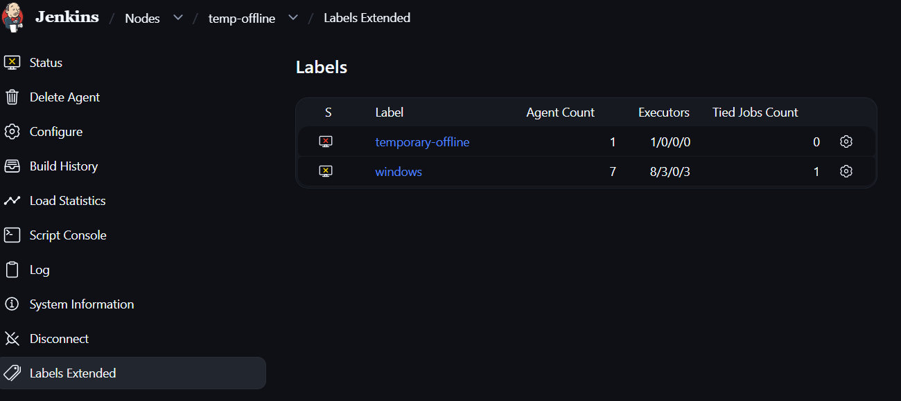
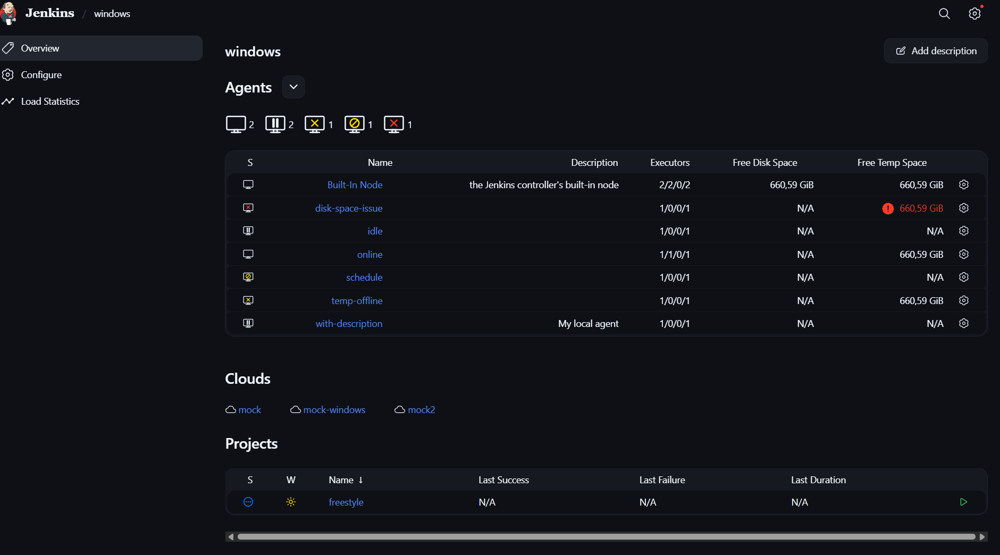

Enhanced Labels View
====================

## Introduction

The plugin adds 2 new features:
- An action is added to agents showing a detailed view of the labels assigned to the agent. This allows users to quickly see the status of
labels that are associated with an agent and get more information about those labels.
- Replace the short list of agents on a label or label expression with a more detailed view of the agents, showing their name, status,
and other relevant information. This can be particularly useful for administrators and users who want to quickly assess the state of their Jenkins
environment. This page also shows the clouds that are able to provision agents for this label or label expression.

Agent Page:

Label Page:

## Getting started

There is no setup needed as of now. Just install the plugin and visit a label or label expression page to see the enhanced view.

## LICENSE

Licensed under MIT, see [LICENSE](LICENSE.md)

